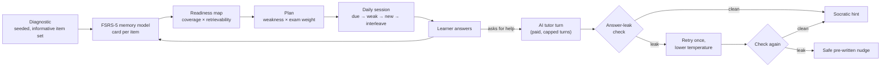

# ProfeIA: Exam Prep for Chilean Teachers, with an AI Tutor That Won't Give Away the Answer

**A study platform for the ECEP teacher-evaluation exam. It runs a diagnostic, builds a personal plan, schedules spaced-repetition practice, and adds a Socratic AI tutor with application-level guardrails.**

[**Live website**](https://profeia.cl) · [**Application**](https://app.profeia.cl) · [Marco Alvarado](https://github.com/7pixel-cl) · [Portfolio](https://7pixel.cl) · [LinkedIn](https://www.linkedin.com/in/marcoalvaradot/)

**[Read the full case study online →](https://7pixel-cl.github.io/profeia-showcase/)**

> Production source is private. This repository is a public case study with approved imagery. It contains no code, learner records, or exam content.

*ProfeIA study interface (October 2026), showing the workflow only; no learner data.*

## At a glance

| | |
| --- | --- |
| **Role** | Sole engineer: product design, learning engine, AI, content pipeline, payments, deployment |
| **Timeline** | June 2026 to present (~350 commits) |
| **Status** | Live, with paid plans (Mercado Pago, CLP) |
| **Codebase** | ~64k lines of TypeScript, 41 tables, 22 tRPC routers with 164 procedures, ~430 automated tests |
| **Content** | ~2,000 practice items across 22 subjects, plus lessons, glossaries and mock exams |

## The problem

Every Chilean public-school teacher sits the ECEP, an evaluation that affects their career track and salary. The syllabus is broad. Most teachers study after work, on a phone, sometimes with bad connectivity. The usual materials are PDFs and question banks. They don't tell you **what to study next**, when to review it, or **why** an answer was wrong.

Off-the-shelf AI chatbots make that worse. Ask one about a practice question and it will usually just tell you the answer, which feels helpful but defeats the purpose of practising.

## What I built

- **Free diagnostic.** An adaptive starting test covers every domain and seeds the learner's memory model.
- **Readiness map and plan.** Mastery is rolled up the syllabus tree. Focus areas are ranked by *weakness × exam weight*, and the plan shows whether the learner is on track for exam day.
- **"Your 5 for today".** A short daily session mixes due reviews, weak topics, and new material, in a lesson-then-retrieve format.
- **Socratic AI tutor and self-explanation grading.** It guides the learner's reasoning instead of handing out answers.
- **Mock exams that match the official blueprint**, past exams, glossary, concept-deck games, and podcasts.
- **Habit features.** Streaks forgive a missed day, and WhatsApp reminders and study sessions bring learners back.
- **Offline PWA.** It can be installed. Practice works offline and syncs safely when the learner reconnects.
- **Admin console** for content, drafts, media, campaigns, and system health.

## Learning engine and tutor flow

## Engineering highlights

### 1. Guardrails that live in code, not only in the prompt
The tutor's teaching behaviour is enforced by an application-level **answer-leak detector**. It catches:

- the correct option restated, using word-shingle overlap;
- giveaway phrasing;
- the correct letter being named;
- feedback patterns that undermine the learner.

If a model response leaks, the system retries once at lower temperature. If it leaks again, it falls back to a safe pre-written hint. The **same checks run on AI-generated practice items** before they can be published.

### 2. A pure, deterministic learning engine
Scheduling (an FSRS-5 implementation), diagnostics, mastery, plans, sessions and mock-exam assembly live in a core package with **no runtime dependencies**. Randomness is seeded and time is injected, so the engine is fully unit-tested and runs **on the client, offline**.

### 3. Offline-first progress sync
Reviews made offline go into a local outbox and sync later. On the server the newest review wins, and review logs are deduplicated, so replaying a queue after reconnecting can't corrupt a learner's history.

### 4. A content pipeline with a human in the loop
Exam content is version-controlled JSON validated with Zod. I built an **MCP server**, local over stdio and remote over HTTPS with OAuth 2.1, so AI agents can draft new items and lessons. The server enforces the same guardrails, and drafts stay drafts until a human promotes them.

### 5. Monetisation without runaway AI costs
Procedures are tiered: public, user, paid, AI and admin. The free trial deliberately excludes AI features. Tutor sessions cap their turns and context window, and every model call's tokens and cost are logged. Payment webhooks are verified by signature and grant access idempotently through retrying background jobs.

## Stack

Next.js 16 · React 19 · TypeScript · tRPC 11 · Drizzle ORM · PostgreSQL (Neon) · Better Auth (magic link, OTP, Google, MCP OAuth) · Vercel AI SDK + AI Gateway (Claude Haiku / Sonnet) · Model Context Protocol · Inngest · Mercado Pago · Twilio WhatsApp · Resend · PostHog · Vercel Blob · PWA (service worker + IndexedDB) · Vitest · Turborepo + pnpm · Vercel

## What I learned

Generating fluent text is the easy part of AI tutoring. The product only works if the tutor's **teaching policy is explicit and testable**, and if the surrounding system (spaced repetition, plans, reminders) gets the learner back for the next session. Keeping the learning engine pure and deterministic made it fast to change with confidence.

---

© 2026 Marco Alvarado. All rights reserved. Product names and third-party marks belong to their owners. This showcase does not license the production software.
