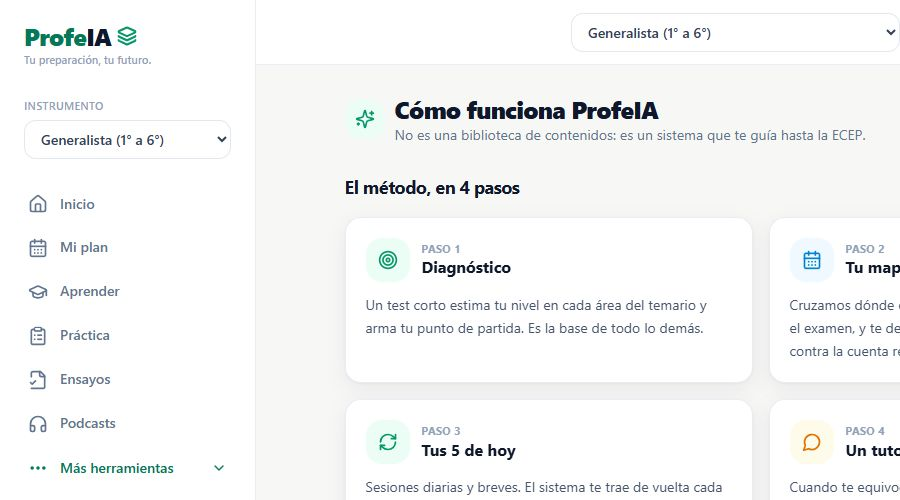

# ProfeIA — Public Product Showcase

**A guided study system for teachers preparing for the ECEP**

Teachers preparing for the ECEP need a manageable route through a broad syllabus. I built ProfeIA to connect diagnostics, a personal study plan, daily practice, and guided AI feedback in one web application.

[Live website](https://profeia.cl) · [Application](https://app.profeia.cl) · [Marco Alvarado](https://github.com/7pixel-cl) · [Hire on Upwork](https://www.upwork.com/freelancers/~01dadbf4c232f73f55)

**Role:** Full-Stack Developer  
**Stack:** Next.js, React, TypeScript, PostgreSQL, Vercel AI SDK

This repository contains public portfolio documentation and approved product imagery. It does not contain the production application's source code.

*ProfeIA product interface, captured for the portfolio in October 2026. The image shows the study workflow, not learner records or outcome metrics.*

## Hook

I built a study product around the next useful action: understand the learner's starting point, organize the syllabus, and bring them back to focused practice. The result is a working web experience linking diagnostics, planning, practice, and a tutor.

## Context & Problem

ProfeIA serves Chilean teachers preparing for the ECEP. A collection of learning materials alone leaves learners to decide what to study, when to review it, and how to interpret a wrong answer. My role is full-stack product development, connecting the learning interface with the study logic and AI integration.

## Technical Discovery

The key question was how to add useful AI help without replacing the learner's reasoning with an answer. The implemented approach combines model-generated coaching with response checks and fallback hints. Compared with relying on a prompt alone, application-level checks add a separate control point before feedback reaches the learner. This adds validation and fallback work, but makes the tutoring behavior explicit in the application. The web application also keeps study logic and AI-related policy in shared modules rather than scattering it across individual screens.

## Implementation Decisions & Challenges

The product brings together diagnostics, personalized study plans, spaced practice, progress tracking, and a Claude-powered Socratic tutor. A concrete challenge is answer leakage: a helpful-sounding response can disclose the answer instead of helping the learner reason. I implemented response checks, retry behavior, and fallback hints to reduce that risk. The project includes tests around the tutoring policy and study logic. Those safeguards are engineering controls, not a claim that model output is infallible.

## Outcomes

Delivered capabilities include a diagnostic starting point, an individual study plan, practice and review, progress tracking, and guided feedback. The public website and application provide product evidence. This showcase makes no claim about exam score improvements, conversion, revenue, or active-user counts; those outcomes require measured evidence.

## Learnings

The technical takeaway is that AI tutoring needs a defined teaching behavior and an application-controlled fallback. Generating fluent text is only one part of the feature. The useful review question is whether the feedback advances the learner's reasoning while preserving the purpose of the exercise.

## Repository contents

- `README.md`: the public project overview and case study.
- `case-study.md`: the case study with metadata for reuse.
- `case-study.html`: a standalone HTML reading version; download and open it locally.
- `images/`: approved public portfolio screenshot.

## Source availability

Production source code remains private. This is a documentation showcase, not a runnable application or an open-source release. No client records, credentials, proprietary source files, or internal database schemas are included.

## Rights

Copyright © 2026 Marco Alvarado. All rights reserved. Product names and third-party marks belong to their respective owners. Publication of this showcase does not license the production software.
